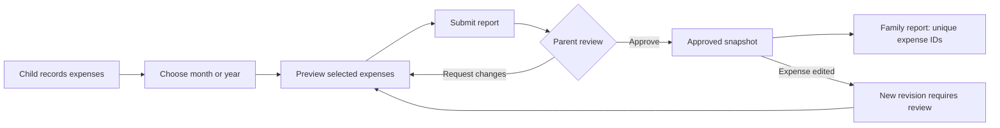

# Cashy — Product requirements

Version 1.0 · 13 October 2026 · Owner: Hamza Malik · Status: approved direction, implementation in progress

## 1. Product and outcome

Cashy is an invite-only personal and family finance application for desktop and mobile browsers, installable as a PWA. It helps the owner understand daily, monthly and yearly expenses, income, savings, investments and family spending in one place. The interface adapts Cashiro's existing visual language to the web. Launch includes every feature agreed in the conversation; implementation milestones are sequencing, not scope cuts.

Primary outcomes: record an expense quickly; reconcile a PDF statement safely; see accurate balances and period reports; plan a budget or goal; understand investments and net worth; consolidate a child's shared expenses without duplicates; ask useful questions about authorized financial data.

## 2. Confirmed decisions and assumptions

| Item | Decision |
| --- | --- |
| Application | Cashy; Next.js App Router, React and TypeScript |
| Devices | Responsive web; mobile PWA; no native SMS access |
| Design | Cashiro source/screenshots as reference; original web components, warm dark default and light alternative |
| Access | Personal use with invited family; no public registration |
| Identity | Clerk; Google/email sign-in, session management, optional MFA |
| Storage | Cloud PostgreSQL via Supabase, with Clerk third-party identity and row-level access controls |
| Currency | PKR default; USD supported; never silently sum mixed currencies |
| Locale | English initially, Asia/Karachi default; configurable timezone |
| AI | Server-side provider adapter, explicit consent, least financial context needed |
| Children | Both adults and minors; adult independent login, guardian-managed profile for minors by default |
| Reporting | Calendar day/month/year initially; custom range and timezone-aware boundaries |
| Launch | All modules below; production remains gated by tests and real service configuration |

Unverified bank formats are not advertised as supported. Automatic bank connections, trading, tax filing, money movement, OCR for arbitrary scanned documents, public social features and native SMS parsing are outside launch scope. Manual investments and reviewed digital PDF imports remain in scope.

## 3. Personas and first-use flow

Owner: manages their money and optionally a household. Parent: manages delegated family responsibilities and reviews shared spending. Adult child: maintains private records and chooses what to share. Minor: uses a guardian-managed profile; an independent login is introduced only after the provider's age requirements and applicable rules have been checked.

First use: sign in with an allowed identity → choose display name/timezone/base currency → create cash/bank accounts with opening balances and dates → add first income/expense or import PDF → optionally create family → set budget/goal. New live accounts start empty. Demonstration data is explicitly labeled and isolated from live records.

## 4. Information architecture

Desktop sidebar: Overview, Transactions, Accounts, Budgets, Goals, Investments, Reports, Family, Subscriptions, Import statements, Assistant, Settings. Mobile floating bar: Home, Activity, Reports, More; More exposes all remaining modules. A persistent add action opens an accessible expense/income/transfer dialog. Filters preserve date range, currency and personal/family scope across relevant pages. Primary totals always show their reporting scope and currency.

## 5. Feature requirements and acceptance

### F01 — Ledger, income and accounts

- Add/edit/archive expenses and income with positive amount, currency, account, category/subcategory, merchant/source, date, note and optional recurring link. Search/filter by date, type, account, category and text. Provide empty/loading/error states.
- Accounts: cash wallet, bank, savings, credit/liability and investment accounts; opening balance and reconciliation date. Archive referenced accounts instead of losing history.
- Transfers have a source, destination, linked identifier and two balanced entries. Same-currency principal nets to zero. Cross-currency transfers preserve both amounts, user-confirmed rate and fees. Fees are expenses. Family allowance is a transfer; child purchases are expenses.
- Amounts stored as integer minor units; enforce safe ranges. Never use floating-point amounts for ledger storage. Mutations require idempotency keys and ownership checks.
- Acceptance: adding an expense updates its account, period/category totals and budget exactly once; editing/deleting reverses prior effects; transfers do not inflate income/expense.

### F02 — Budgets, categories and goals

- Monthly total/category budgets, visual progress, remaining/overspent values and previous-period history. Alert at 80% and 100%; actual overruns remain visible even if the bar is visually capped.
- Manage custom categories and subcategories; protect historical references when archived.
- Savings goals contain target, target date, currency and linked contributions. Contributions are allocations/transfers, not new expenses. Prevent allocating the same available balance twice.
- Acceptance: current-month expenses alone affect matching budgets; no division by zero; completed goals and overspent budgets render correctly.

### F03 — Analytics and reports

- Daily/monthly/yearly/custom-range income, expense, net cash flow, category breakdown, spending trend, heatmap, budget history and savings progress.
- Net worth uses assets minus liabilities, with latest investment valuations and explicit valuation timestamps. Do not count an investment both as a holding and account cash.
- Export filtered transactions as escaped CSV and print/download a readable period report. Exports enforce exactly the same permissions as the screen.
- Acceptance: report totals reconcile to ledger, dates follow selected timezone, income is separated from transfers, empty periods show zero, family and personal scope are distinguishable.

### F04 — PKR and USD

- Every account/transaction/goal/holding has an explicit currency. Default to PKR; retain original USD amounts.
- Initially show separate currency totals. Optional consolidated reporting requires an explicit stored rate, source and as-of date, displaying that conversion is an estimate. Never present a hardcoded exchange rate as live.
- Historical reports retain conversion provenance. Rounding occurs at defined boundaries, not repeatedly during aggregation.
- Acceptance: PKR and USD filters never silently omit currency labels or sum raw amounts.

### F05 — PDF statements (required launch feature)

Select PDF → validate type/signature/size (10 MB) and page limit (100) → extract text in a restricted parser → select account/currency and statement template → show editable candidate rows → highlight low confidence and possible duplicates → confirm selected rows → atomically import → show import receipt and undo option.

Digital text PDFs supported first. Cashiro's GPay/PhonePe patterns are research references; Pakistani bank templates are released only against representative sanitized statements. Provide generic review/edit fallback. Encrypted/scanned/unsupported documents return a clear actionable error; never report success with no extracted transactions. Passwords are transient and never logged. Default original-file retention is none after processing; keeping a PDF requires explicit choice and private storage. Expire failed uploads within 24 hours. Deduplication uses account + date + currency + amount + normalized merchant/reference, with user review for ambiguous matches. Repeat imports must not create duplicate confirmed rows.

Acceptance: valid fixture imports exact amounts/dates/types after confirmation; reimport is flagged; cancellations add nothing; parser failures create no ledger entries; unauthorized users cannot retrieve uploads or extracted text.

### F06 — Investments and net worth

- Manual holdings: asset name/type, units, cost basis, currency, latest valuation and valuation date; purchases, sales and income events.
- Show contributed capital, realized/unrealized gain/loss and portfolio composition. Returns use documented cash-flow handling; avoid misleading percentage returns with zero cost basis.
- Manually updated values are labeled; no claim of live market prices. Investment purchases move value into an asset, not consumption expense. Dividends are income; fees are expenses.

### F07 — Recurring payments, reminders and profile

- Create/edit recurring income/expenses and subscriptions with amount, currency, cadence, next due date and account. Detect candidate recurring merchants, then request confirmation.
- Upcoming/in-app reminders and budget alerts; browser push is opt-in and dependent on browser capability. Due reminders do not silently post transactions. Marking paid links one transaction and advances the schedule idempotently.
- Profile, theme, timezone/currency, notification preferences and session controls. Explicit backup/export and version-validated restore with duplicate preview.

### F08 — Family and child accounts

Family owner creates household → invites a parent or adult child by expiring, single-use link → invitee accepts the exact role and sharing terms → creates separate financial records. Invitation delivery is an explicit user action. A parent may instead create a managed child profile without a separate login. No fabricated child identity or shared password.

Sharing modes: manual report submission (default for adult children), automatic sharing of selected accounts/categories, or guardian-managed recording for minors. Show who can see what in the child's interface. Parents do not automatically see adult children's private records. Managed-profile visibility is explicit at creation.

Period flow: select month/year → child previews eligible expenses → submit report with immutable item versions and totals → parent reviews → approve or request changes with note → approved items appear in family reports. Statuses: draft, submitted, changes requested, approved, superseded. Monthly reminders and year-end rollups assist submission but never auto-approve.

Family aggregation references canonical expense IDs with a uniqueness constraint. Annual reports union approved IDs across monthly reports; a separate annual submission cannot duplicate them. Parent approval does not create another personal expense. Reimbursement is a linked transfer, not a second expense. Editing a submitted expense creates a new revision requiring review; approved snapshots remain auditable. Revoking automatic sharing stops future visibility; the user is told which submitted snapshots remain for audit. Leaving a household ends active access while preserving each person's own records.

| Capability | Owner | Parent | Adult child | Managed child |
| --- | --- | --- | --- | --- |
| Own private records | Yes | Yes | Yes | Guardian-managed profile |
| Invite/manage family | Yes | Delegated only | No | No |
| Read another adult's private ledger | No | No | No | No |
| Review shared reports | Yes | Assigned reviewer | Own submissions only | As configured visibly |
| Submit own reports | Yes | Yes | Yes | Guardian-assisted |
| Modify another adult's transaction | No | No | No | No |
| Export approved family report | Yes | Assigned reviewer | Own report | Guardian-assisted |

Acceptance: nonmember and sibling access denied; membership alone never grants private ledger visibility; repeated approval is idempotent; monthly/yearly rollups count one expense once; a reviewer cannot approve a changed unsubmitted revision.

### F09 — AI assistant

- Questions over authorized records: category/period totals, spending comparisons, budget explanations, unusual expenses and monthly review drafts. Display scope, period and data used.
- Compute financial arithmetic in trusted application code; AI explains those results. Missing information yields an honest limitation, not invented transactions or forecasts.
- Before external processing, show provider, fields sent and consent setting. Default to aggregate/category summaries; exclude PDF originals, account numbers, child identifiers and merchant notes unless specifically needed and authorized.
- AI cannot move money, post/edit/delete transactions, change permissions or provide guaranteed investment outcomes. Proposed changes require user review. Treat imported text as untrusted data, never system instructions.
- Authentication, authorization, quotas, timeouts and redacted logs on every request. Provider failure yields retry and keeps deterministic reports usable. Non-AI preview insights are labeled as such.

## 6. Visual system and motion

Reference: Cashiro checkout 40a387fd0bb87bdc51c80124e0fbf084e8a2b2ce. Reviewed home/analytics screenshots, Color.kt, Type.kt, HomeScreen.kt, BudgetCard.kt and CashiroBottomNavigation.kt.

Preserve warm near-black backgrounds, peach/coral accents, cream text, muted secondary text, large rounded surfaces, tonal account cards, category icon containers, pill controls, prominent amounts and floating mobile navigation. Use clear desktop hierarchy with a compact sidebar, generous content gutters and a two-column dashboard. Build reusable web equivalents of account cards, transaction rows, budget progress cards, period selectors, subscription rows, chart cards and bottom sheets.

Motion: short opacity/translation transitions around 180–260 ms; progress/chart entry 600–800 ms; subtle pressed states; mobile sheets slide from bottom. Respect prefers-reduced-motion. Avoid animating layout on every render or blocking tasks. Financial values remain legible during transitions.

Accessibility: keyboard navigation, visible focus, semantic headings, dialog focus trap/Escape/return focus, labels and announced errors, text alternatives for charts, 44px touch targets, WCAG AA contrast target and non-color status indicators. Test 360px, 390px, 768px and 1440px widths.

## 7. Architecture and data

Next.js server routes/actions enforce authentication and input validation. Clerk establishes identity; Supabase PostgreSQL stores finance data with RLS tied to Clerk subject. Browser code never receives a service-role key. Privileged jobs use narrow database functions with explicit authorization. Private object storage is only used when PDF retention is requested. Hosting target: a Next.js-compatible runtime; final hosting configuration follows service setup. Sites may host a clearly labeled preview separately, but does not replace the agreed Next.js architecture.

Entities: profiles, access_allowlist, households, memberships, invites, managed_profiles, accounts, categories, transactions, transfer_groups, budgets, budget_periods, goals, goal_contributions, holdings, investment_events, valuations, subscriptions, reminders, import_batches, import_candidates, report_submissions, report_items, approvals, sharing_policies, ai_consents, audit_events and export_jobs. Every financial row has immutable ID, owner subject/profile, currency, timestamps and version. All household references include membership validation. Reports reference transaction versions, not untracked copied amounts.

Separate domain modules for money, time periods, transfers, deduplication and report visibility. Separate storage adapters for explicitly synthetic local demo and authenticated cloud. Production must fail closed when configuration is missing; no implicit demo identity fallback.

## 8. Security, privacy and operations

- Invite/allowlist enforcement server-side, beyond hiding sign-up links. MFA encouraged for administrators; sensitive exports/deletion require recent authentication.
- Row ownership and household permission checks for reads, writes, exports, AI and file URLs. Prevent role escalation and object-ID guessing. Test RLS with real user tokens.
- Secure session cookies managed by identity provider, CSRF/origin validation for mutations, CSP and standard response headers, input/schema validation, rate limits, no secrets in public environment variables.
- TLS in transit, provider encryption at rest, private buckets, short-lived signed URLs and documented backup retention. No claim of end-to-end encryption: the server processes records.
- No financial text or tokens in logs/analytics. Audit permission changes, imports, report approval and destructive operations; retain only necessary metadata.
- Offline launch behavior: cached public shell/offline page only. Financial API responses, identity pages and PDFs are never service-worker cached. Full offline editing/conflict resolution is future work. Clear in-memory private state at logout.
- Export own data; verified account deletion flow explains family snapshot retention, cancels jobs, deletes owned uploads and queues database cleanup. Restore is tested before production, including deletion propagation through backup retention.

## 9. Release gates and success measures

Release requires working invite-only login, configured cloud with tested isolation, financial arithmetic and transfer tests, PDF fixture/reimport checks, adult/minor sharing and revocation tests, import/export authorization tests, reduced-motion/keyboard/mobile review, no critical dependency findings, error monitoring without sensitive payloads, backup restore test and service keys configured outside source control.

Performance targets: dashboard readable within 2.5 s on typical mobile connection; core manual transaction flow under 20 s; ordinary list mutations acknowledged within 1 s excluding provider outages; PDF progress/error feedback for slow processing. Verify targets with measurement before claiming them achieved.

Success: totals reconcile exactly, repeat imports/approvals create zero duplicates, every cross-user access test is denied, all agreed modules usable with real configured services. Personal use does not need behavioral tracking; local task timing and aggregate error metrics suffice.

## 10. Dependencies and launch risks

Required deployment inputs: Clerk application/domain and keys; Supabase project/region and keys; owner allowed identity; AI provider and secret; approved hosting/domain; sanitized target bank PDF examples. These can be configured after local implementation. Do not put secrets in PRD or chat logs.

Cashiro uses AGPL-3.0. Preserve notices and license for adaptations; provide corresponding source as required when deploying a covered derivative. Third-party avatars, fonts and artwork require their own provenance checks. The initial build uses original CSS/vector artwork and packaged licensed icons rather than copying unverified artwork. Formal distribution/license review is a release task, not a reason to block local design work.

Main risks: unmatched PDF templates, ambiguous duplicate transactions, false AI explanations, family access leakage, inaccurate currency aggregation and offline stale data. Review-first imports, deterministic calculations, restricted context, server authorization, currency-separated totals and online-only private data directly address these risks.

## Sources

- Cashiro source and license: https://github.com/ritesh-kanwar/Cashiro
- Next.js installation: https://nextjs.org/docs/app/getting-started/installation
- Clerk server routes: https://clerk.com/docs/reference/nextjs/app-router/route-handlers
- Clerk/Supabase integration: https://supabase.com/docs/guides/auth/third-party/clerk
- Supabase RLS: https://supabase.com/docs/guides/database/postgres/row-level-security

